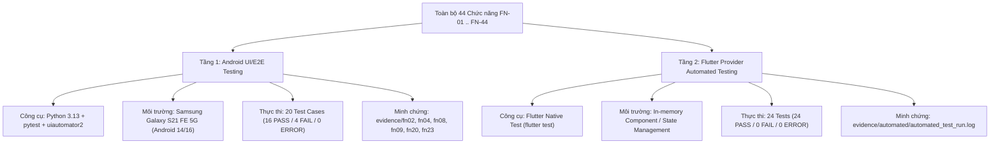
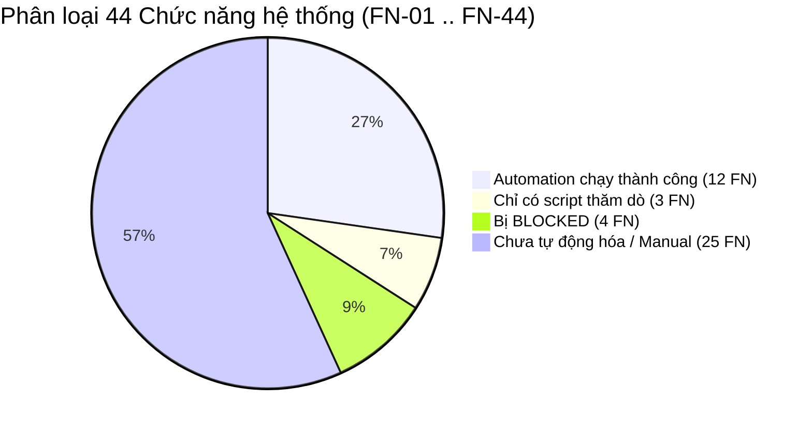

# BÁO CÁO TỔNG HỢP KẾT QUẢ THỰC THI KIỂM THỬ TỰ ĐỘNG (AUTOMATION SUMMARY)
## Dự án: Smart Note App
**Branch kiểm thử:** `huong`  
**Ngày cập nhật:** 12/10/2026  
**Commit tích hợp mới nhất:** `73514ad` (`test(qa): integrate 24 passing automated provider tests from thuong`)  
**Tiêu chuẩn áp dụng:** IEEE 829 & ISTQB Test Execution / Test Automation Reporting  

---

## 1. TỔNG QUAN KIẾN TRÚC KIỂM THỬ TỰ ĐỘNG ĐA TẦNG (TWO-LAYER AUTOMATION)

Để đảm bảo chất lượng phần mềm toàn diện và khắc phục giới hạn của việc kiểm thử giao diện trên thiết bị thật, dự án áp dụng **Kiến trúc Kiểm thử Tự động 2 Tầng (Two-Layer Automation Strategy)**:



| Chỉ số tổng hợp | Tầng 1: Android UI/E2E | Tầng 2: Flutter Provider | Toàn hệ thống Automation |
|---|:---:|:---:|:---:|
| **Framework & Ngôn ngữ** | Python 3.13 + uiautomator2 | Flutter Test (Dart) | Python + Dart |
| **Phạm vi kiểm thử** | Giao diện Black-box đầu cuối | State Management & Repositories | UI + Component State |
| **Tổng số kịch bản đã cài đặt** | 20 Test Cases | 24 Tests | **44 Kịch bản kiểm thử** |
| **Tổng số kịch bản đã thực thi** | 20 Test Cases | 24 Tests | **44 Kịch bản kiểm thử** |
| **Số ca ĐẠT (PASS)** | 16 (80.00%) | 24 (100.00%) | **40 Ca ĐẠT (90.91%)** |
| **Số ca THẤT BẠI (FAIL)** | 4 (20.00%) | 0 (0.00%) | **4 Ca THẤT BẠI (9.09%)** |
| **Lỗi phát hiện (Bugs)** | 3 Application Bugs + 1 Data Issue | 0 | **3 Bugs xác nhận** |
| **Bằng chứng thực thi (Evidence)** | Screenshot từng bước trong `evidence/` | `evidence/automated/automated_test_run.log` | Logs + Screenshots |

---

## 2. KẾT QUẢ THỰC THI TẦNG 2: FLUTTER PROVIDER AUTOMATED TESTING (24 TESTS)

### 2.1. Thông tin thực thi & Dẫn chứng
- **Commit tích hợp:** `73514ad` từ nhánh `thuong`
- **Mã nguồn kiểm thử:**
  - `test/automated/note_provider_test.dart` (15 tests, 476 dòng code, sử dụng `FakeNoteRepository`)
  - `test/automated/sync_provider_test.dart` (9 tests, 178 dòng code, sử dụng `FakeSyncRepository` & Mock MethodChannel)
- **Lệnh thực thi chính thức:**
  ```powershell
  flutter test --no-pub -r expanded test/automated/ 2>&1 | Tee-Object -FilePath evidence/automated/automated_test_run.log
  ```
- **Tệp bằng chứng log (Evidence Log):** [`evidence/automated/automated_test_run.log`](../../evidence/automated/automated_test_run.log)
- **Kết quả tổng thể:** **24/24 PASS (100.00%)**, thời gian thực thi: ~00:01s, Exit code: `0`.

### 2.2. Bảng kết quả chi tiết từng Test Case trong bộ 24 Provider Tests

| STT | File Test | Nhóm kiểm thử (Group) | Tên Test Case | Chức năng (FN) | Kết quả | Dẫn chứng log (`evidence/automated/automated_test_run.log`) |
|:---:|---|---|---|:---:|:---:|---|
| 1 | `note_provider_test.dart` | NoteProvider - Pin note | Ghim ghi chú bình thường thành công | **FN-20** | **PASS** | `00:00 +0: NoteProvider - Pin note Ghim ghi chú bình thường thành công` |
| 2 | `note_provider_test.dart` | NoteProvider - Pin note | Bỏ ghim ghi chú đã ghim thành công | **FN-20** | **PASS** | `00:00 +1: NoteProvider - Pin note Bỏ ghim ghi chú đã ghim thành công` |
| 3 | `note_provider_test.dart` | NoteProvider - Archive note | Lưu trữ ghi chú | **FN-13** | **PASS** | `00:00 +2: NoteProvider - Archive note Lưu trữ ghi chú` |
| 4 | `note_provider_test.dart` | NoteProvider - Archive note | Bỏ lưu trữ ghi chú | **FN-14** | **PASS** | `00:00 +3: NoteProvider - Archive note Bỏ lưu trữ ghi chú` |
| 5 | `note_provider_test.dart` | NoteProvider - Restore note | Khôi phục ghi chú từ thùng rác | **FN-11** | **PASS** | `00:00 +4: NoteProvider - Restore note Khôi phục ghi chú từ thùng rác` |
| 6 | `note_provider_test.dart` | NoteProvider - Create and Edit note | Tạo ghi chú mới thành công | **FN-08** | **PASS** | `00:00 +5: NoteProvider - Create and Edit note Tạo ghi chú mới thành công` |
| 7 | `note_provider_test.dart` | NoteProvider - Create and Edit note | Chỉnh sửa tiêu đề và nội dung ghi chú | **FN-09** | **PASS** | `00:00 +6: NoteProvider - Create and Edit note Chỉnh sửa tiêu đề và nội dung...` |
| 8 | `note_provider_test.dart` | NoteProvider - Search note | Search note by content | **FN-23** | **PASS** | `00:00 +7: NoteProvider - Search note Search note by content` |
| 9 | `note_provider_test.dart` | NoteProvider - Search note | Search note with no matching result | **FN-23** | **PASS** | `00:00 +17: NoteProvider - Search note Search note with no matching result` |
| 10 | `note_provider_test.dart` | NoteProvider - Search note | Clear search | **FN-23** | **PASS** | `00:01 +18: NoteProvider - Search note Clear search` |
| 11 | `note_provider_test.dart` | NoteProvider - Note lifecycle | Xóa ghi chú: chuyển vào thùng rác | **FN-10** | **PASS** | `00:01 +19: NoteProvider - Note lifecycle Xóa ghi chú: chuyển vào thùng rác` |
| 12 | `note_provider_test.dart` | NoteProvider - Note lifecycle | Khôi phục ghi chú từ thùng rác | **FN-11** | **PASS** | `00:01 +20: NoteProvider - Note lifecycle Khôi phục ghi chú từ thùng rác` |
| 13 | `note_provider_test.dart` | NoteProvider - Note lifecycle | Xóa vĩnh viễn ghi chú trong thùng rác | **FN-12** | **PASS** | `00:01 +21: NoteProvider - Note lifecycle Xóa vĩnh viễn ghi chú trong thùng rác` |
| 14 | `note_provider_test.dart` | NoteProvider - Note lifecycle | Xóa ghi chú đã ghim vào thùng rác | **FN-10, FN-20** | **PASS** | `00:01 +22: NoteProvider - Note lifecycle Xóa ghi chú đã ghim vào thùng rác` |
| 15 | `note_provider_test.dart` | NoteProvider - Note lifecycle | Khôi phục ghi chú đã ghim từ thùng rác | **FN-11, FN-20** | **PASS** | `00:01 +23: NoteProvider - Note lifecycle Khôi phục ghi chú đã ghim từ thùng rác` |
| 16 | `sync_provider_test.dart` | SyncProvider - Initial state | Trạng thái ban đầu là idle | **FN-40** | **PASS** | Khởi tạo SyncStatus.idle, isOffline hợp lệ |
| 17 | `sync_provider_test.dart` | SyncProvider - Update user | Không đồng bộ khi userId là null | **FN-40** | **PASS** | Chặn đồng bộ khi không có user |
| 18 | `sync_provider_test.dart` | SyncProvider - Update user | Đồng bộ khi có userId mới | **FN-40** | **PASS** | Tự kích hoạt sync khi nhận user-1 |
| 19 | `sync_provider_test.dart` | SyncProvider - Update user | Không đồng bộ lại khi userId không thay đổi | **FN-40** | **PASS** | Idempotent check: không sync lặp cùng user |
| 20 | `sync_provider_test.dart` | SyncProvider - Update user | Đổi user thì đồng bộ với user mới | **FN-40** | **PASS** | Chuyển user-1 sang user-2 đồng bộ cả 2 |
| 21 | `sync_provider_test.dart` | SyncProvider - Sync now | Phát tín hiệu khi đồng bộ có dữ liệu mới | **FN-40** | **PASS** | Lắng nghe onSyncWithNewData thành công |
| 22 | `sync_provider_test.dart` | SyncProvider - Sync now | Không phát tín hiệu khi không có dữ liệu mới | **FN-40** | **PASS** | Không phát event thừa khi dữ liệu giữ nguyên |
| 23 | `sync_provider_test.dart` | SyncProvider - Sync now | Bắt lỗi khi đồng bộ thất bại | **FN-40** | **PASS** | `SyncProvider Error: Exception: Sync failed` được bắt an toàn |
| 24 | `sync_provider_test.dart` | SyncProvider - Status stream | Cập nhật trạng thái khi repository phát trạng thái mới | **FN-40** | **PASS** | Chuyển trạng thái stream syncing -> success |

---

## 3. KẾT QUẢ THỰC THI TẦNG 1: ANDROID UI/E2E AUTOMATION (20 TEST CASES)

### 3.1. Thông tin thực thi & Dẫn chứng
- **Thiết bị:** Samsung Galaxy S21 FE 5G (SM-G990B / R5CW82ECF6M), Android 14 (API 34)
- **Framework:** Python 3.13 + pytest + uiautomator2 + ADB
- **Thư mục kịch bản:** `automation/tests/`
- **Kết quả tổng thể:** **16 PASS / 4 FAIL** (Tỷ lệ PASS: 80.00%)

### 3.2. Bảng tổng hợp 20 Test Cases UI/E2E

| TC-ID | Chức năng (FN) | Tên kịch bản kiểm thử | Script Path | Result | Ghi chú phân loại / Bug ID | Evidence |
|:--- |:--- |:--- |:--- |:---:|:--- |:--- |
| **TC-BB-001** | FN-02: Đăng ký | Đăng ký tài khoản với Email và Mật khẩu hợp lệ | `test_fn02_register.py` | **PASS** | — | `evidence/fn02/FN02_TC-BB-001_D01_01.png` |
| **TC-BB-002** | FN-02 | Để trống thông tin khi đăng ký | `test_fn02_register.py` | **PASS** | — | `evidence/fn02/FN02_TC-BB-002_D01_01.png` |
| **TC-BB-003** | FN-02 | Đăng ký với định dạng Email không hợp lệ | `test_fn02_register.py` | **FAIL** | BUG-FN02-01 (Sai thông báo lỗi email) | `evidence/fn02/FN02_TC-BB-003_D01_01.png` |
| **TC-BB-004** | FN-02 | Đăng ký với mật khẩu ngắn dưới 6 ký tự | `test_fn02_register.py` | **PASS** | — | `evidence/fn02/FN02_TC-BB-004_D02_01.png` |
| **TC-BB-005** | FN-02 | Đăng ký với email đã tồn tại trên hệ thống | `test_fn02_register.py` | **PASS** | — | `evidence/fn02/FN02_TC-BB-005_D01_01.png` |
| **TC-BB-006** | FN-04: Đăng nhập | Đăng nhập thành công với tài khoản Email hợp lệ | `test_fn04_login.py` | **FAIL** | Precondition Issue: Email chưa verified | `evidence/fn04/FN04_TC-BB-006_D01_01.png` |
| **TC-BB-007** | FN-04 | Đăng nhập thất bại do sai Mật khẩu | `test_fn04_login.py` | **FAIL** | BUG-BB-003 (Thông báo Firebase gộp) | `evidence/fn04/FN04_TC-BB-007_D01_01.png` |
| **TC-BB-008** | FN-04 | Đăng nhập thất bại do tài khoản không tồn tại | `test_fn04_login.py` | **FAIL** | BUG-BB-002 (Thông báo Firebase gộp) | `evidence/fn04/FN04_TC-BB-008_D01_01.png` |
| **TC-BB-009** | FN-04 | Đăng nhập thất bại do để trống Mật khẩu | `test_fn04_login.py` | **PASS** | — | `evidence/fn04/FN04_TC-BB-009_D01_01.png` |
| **TC-BB-016** | FN-08: Tạo note | Tạo ghi chú văn bản có Tiêu đề và Nội dung | `test_fn08_create_note.py` | **PASS** | — | `evidence/fn08/FN08_TC-BB-016_D01_01.png` |
| **TC-BB-017** | FN-08 | Tạo ghi chú không có tiêu đề nhưng có nội dung | `test_fn08_create_note.py` | **PASS** | — | `evidence/fn08/FN08_TC-BB-017_D01_01.png` |
| **TC-BB-018** | FN-08 | Tạo ghi chú trống cả 2 ô; không tạo note rỗng | `test_fn08_create_note.py` | **PASS** | — | `evidence/fn08/FN08_TC-BB-018_D01_01.png` |
| **TC-BB-019** | FN-09: Sửa note | Chỉnh sửa nội dung ghi chú | `test_fn09_edit_note.py` | **PASS** | — | `evidence/fn09/FN09_TC-BB-019_D01_01.png` |
| **TC-BB-020** | FN-09 | Kiểm tra tự động lưu nội dung sau khi sửa | `test_fn09_edit_note.py` | **PASS** | — | `evidence/fn09/FN09_TC-BB-020_D01_01.png` |
| **TC-BB-024** | FN-20: Ghim | Ghim ghi chú lên đầu danh sách Trang chủ | `test_fn20_pin_note.py` | **PASS** | — | `evidence/fn20/FN20_TC-BB-024_D01_01.png` |
| **TC-BB-025** | FN-20 | Bỏ ghim ghi chú trở về danh sách thông thường | `test_fn20_pin_note.py` | **PASS** | — | `evidence/fn20/FN20_TC-BB-025_D01_01.png` |
| **TC-BB-026** | FN-23: Tìm kiếm | Tìm kiếm ghi chú theo từ khóa Tiêu đề | `test_fn23_search.py` | **PASS** | — | `evidence/fn23/FN23_TC-BB-026_D01_01.png` |
| **TC-BB-027** | FN-23 | Tìm kiếm ghi chú theo từ khóa Nội dung | `test_fn23_search.py` | **PASS** | — | `evidence/fn23/FN23_TC-BB-027_D01_01.png` |
| **TC-BB-028** | FN-23 | Tìm kiếm với từ khóa không tồn tại | `test_fn23_search.py` | **PASS** | — | `evidence/fn23/FN23_TC-BB-028_D01_01.png` |
| **TC-BB-029** | FN-23 | Tìm kiếm với chuỗi Ký tự đặc biệt / SQL Injection | `test_fn23_search.py` | **PASS** | — | `evidence/fn23/FN23_TC-BB-029_D01_01.png` |

---

## 4. ĐỐI CHIẾU 24 TEST MỚI VỚI 44 CHỨC NĂNG (FN-01 ĐẾN FN-44)

### 4.1. Phân biệt rạch ròi số TEST và số CHỨC NĂNG (FN)
- **Số lượng test:** **24 automated tests** (chạy thành công 24/24 PASS qua `flutter test`).
- **Số lượng chức năng (FN) được bao phủ:** **10 chức năng (FNs)** trên tổng số 44 FNs của hệ thống.
- **Quan hệ phân bổ:** Một chức năng thường được kiểm thử bởi nhiều test cases để bao quát các trường hợp biên, giá trị null và xử lý ngoại lệ:
  - `FN-40` (Đồng bộ dữ liệu & Vòng đời): **9 tests** (trạng thái idle, null user, user mới, user trùng lặp, chuyển đổi user, phát event dữ liệu mới, không phát event thừa, bắt ngoại lệ an toàn, cập nhật status stream).
  - `FN-11` (Khôi phục ghi chú từ thùng rác): **3 tests** (khôi phục note thường từ restore group, khôi phục note thường từ lifecycle group, khôi phục note đã ghim).
  - `FN-20` (Ghim & Bỏ ghim ghi chú): **2 tests chuyên biệt** + **2 tests phối hợp với thùng rác** (xóa note đã ghim, khôi phục note đã ghim).
  - `FN-23` (Tìm kiếm ghi chú): **3 tests** (tìm theo nội dung, tìm không thấy kết quả, xóa trạng thái tìm kiếm).
  - `FN-10` (Chuyển vào thùng rác): **2 tests** (xóa note thường, xóa note đã ghim).
  - `FN-08` (Tạo ghi chú): **1 test** (tạo note mới).
  - `FN-09` (Cập nhật ghi chú): **1 test** (sửa tiêu đề và nội dung).
  - `FN-12` (Xóa vĩnh viễn): **1 test** (xóa vĩnh viễn khỏi thùng rác).
  - `FN-13` (Lưu trữ ghi chú): **1 test** (chuyển vào archive).
  - `FN-14` (Bỏ lưu trữ ghi chú): **1 test** (bỏ lưu trữ trở về danh sách chính).

### 4.2. Phân tích chức năng trùng lặp (Duplications & Overlaps)
1. **Trùng lặp nội bộ trong chính bộ 24 Provider tests:**
   - Test #5 (`NoteProvider - Restore note: Khôi phục ghi chú từ thùng rác`) và Test #12 (`NoteProvider - Note lifecycle: Khôi phục ghi chú từ thùng rác`) có logic và mục tiêu kiểm thử giống hệt nhau (cùng đưa note vào trash, gọi `restoreNote`, assert note trở về active list với status `'normal'`). Đây là sự trùng lặp (redundancy) mã nguồn kiểm thử nội bộ.
2. **Chồng lấn đa tầng giữa Provider Automated Tests và UI Automated Tests:**
   - 4 chức năng `FN-08` (Tạo note), `FN-09` (Sửa note), `FN-20` (Ghim note), `FN-23` (Tìm kiếm note) đã có kịch bản E2E UI bằng Python uiautomator2 trên máy thật.
   - **Đánh giá giá trị:** Đây **không phải là trùng lặp lãng phí**, mà là **sự bổ trợ đa tầng (Multi-tier testing)** theo mô hình kim tự tháp kiểm thử chuẩn ISTQB:
     - Tầng Provider kiểm thử trạng thái logic cực nhanh (~1.5s), không phụ thuộc thiết bị ngoại vi, dễ chạy trong CI/CD.
     - Tầng UI E2E kiểm thử khả năng render, bàn phím ảo, tương tác cảm ứng và độ trễ thực tế trên Android.
3. **Các chức năng MỚI ĐƯỢC BỔ SUNG mà UI E2E chưa tự động hóa được:**
   - `FN-10`, `FN-11`, `FN-12` (Quản lý Thùng rác): Trong `automation_plan.md` ban đầu xếp vào Phase 2 (Planned, chưa có code UI). Nhờ 24 tests mới, 3 chức năng này **đã có kiểm thử tự động hóa ở tầng Provider**!
   - `FN-13`, `FN-14` (Lưu trữ / Archive): Trước đây chỉ có manual screenshot, nay đã có automated test chính thức!
   - `FN-40` (Đồng bộ dữ liệu): Trong `automation_plan.md` xếp vào Phase 3 (Deferred do yêu cầu 2 máy thật). Nay các nhánh luồng logic phức tạp nhất của `SyncProvider` đã được tự động hóa triệt để (9 tests).

### 4.3. Ma trận đối chiếu toàn diện 44 chức năng (FN-01 đến FN-44) với Automated Testing

| Mã FN | Tên chức năng hệ thống | Mức ưu tiên | Tầng 1: Android UI E2E | Tầng 2: Provider Automated (24 Tests) | Trạng thái phân loại tự động hóa |
|:---:|:---|:---:|:---:|:---:|:---|
| **FN-01** | Validate form đăng nhập | P1 | Chưa có script độc lập | Chưa có trong `test/automated/` | **Chưa tự động hóa (Manual)** |
| **FN-02** | Đăng ký tài khoản Email/Pass | P1 | **Có (5 TCs: 4 PASS / 1 FAIL)** | Chưa có trong `test/automated/` | **Automation chạy thành công** |
| **FN-03** | Xác thực email | P2 | Chưa có script E2E độc lập | Chưa có trong `test/automated/` | **Chưa tự động hóa (Manual)** |
| **FN-04** | Đăng nhập tài khoản Email/Pass | P1 | **Có (4 TCs: 1 PASS / 3 FAIL)** | Chưa có trong `test/automated/` | **Automation chạy thành công** |
| **FN-05** | Đăng nhập Google OAuth | P1 | Script thăm dò (`test_fn05_google_oauth.py`)| Chưa có trong `test/automated/` | **Chỉ có script thăm dò** |
| **FN-06** | Đặt lại mật khẩu | P2 | Chưa có | Chưa có | **Chưa tự động hóa (Manual)** |
| **FN-07** | Đăng xuất tài khoản | P1 | Chưa có | Chưa có | **Chưa tự động hóa (Manual)** |
| **FN-08** | Tạo ghi chú văn bản | P1 | **Có (3 TCs: 3 PASS)** | **Có (1 Test: PASS)** | **Automation chạy thành công** |
| **FN-09** | Cập nhật ghi chú & Autosave | P1 | **Có (2 TCs: 2 PASS)** | **Có (1 Test: PASS)** | **Automation chạy thành công** |
| **FN-10** | Chuyển ghi chú vào thùng rác | P1 | Chưa có E2E UI | **Có (2 Tests: PASS)** | **Automation chạy thành công** |
| **FN-11** | Khôi phục ghi chú từ thùng rác | P1 | Chưa có E2E UI | **Có (3 Tests: PASS)** | **Automation chạy thành công** |
| **FN-12** | Xóa ghi chú vĩnh viễn | P1 | Chưa có E2E UI | **Có (1 Test: PASS)** | **Automation chạy thành công** |
| **FN-13** | Lưu trữ ghi chú (Archive) | P2 | Chưa có E2E UI | **Có (1 Test: PASS)** | **Automation chạy thành công** |
| **FN-14** | Bỏ lưu trữ ghi chú (Unarchive) | P2 | Chưa có E2E UI | **Có (1 Test: PASS)** | **Automation chạy thành công** |
| **FN-15** | Tạo ghi chú checklist | P1 | Chưa có | Chưa có | **Chưa tự động hóa (Manual)** |
| **FN-16** | Thêm mục checklist | P1 | Chưa có | Chưa có | **Chưa tự động hóa (Manual)** |
| **FN-17** | Tick hoàn thành mục checklist | P1 | Chưa có | Chưa có | **Chưa tự động hóa (Manual)** |
| **FN-18** | Bỏ tick mục checklist | P1 | Chưa có | Chưa có | **Chưa tự động hóa (Manual)** |
| **FN-19** | Xóa mục checklist | P1 | Chưa có | Chưa có | **Chưa tự động hóa (Manual)** |
| **FN-20** | Ghim & Bỏ ghim ghi chú | P1 | **Có (2 TCs: 2 PASS)** | **Có (4 Tests: PASS)** | **Automation chạy thành công** |
| **FN-21** | Tạo nhãn (Create Tag) | P2 | Chưa có | Chưa có | **Chưa tự động hóa (Manual)** |
| **FN-22** | Gắn nhãn vào ghi chú | P2 | Chưa có | Chưa có | **Chưa tự động hóa (Manual)** |
| **FN-23** | Tìm kiếm văn bản & lọc | P1 | **Có (4 TCs: 4 PASS)** | **Có (3 Tests: PASS)** | **Automation chạy thành công** |
| **FN-24** | Lọc ghi chú có ảnh (`has:image`) | P2 | Chưa có | Chưa có | **Chưa tự động hóa (Manual)** |
| **FN-25** | Lọc ghi chú có liên kết (`has:url`) | P2 | Chưa có | Chưa có | **Chưa tự động hóa (Manual)** |
| **FN-26** | Lọc ghi chú có âm thanh (`has:audio`)| P2 | Chưa có | Chưa có | **Chưa tự động hóa (Manual)** |
| **FN-27** | Lọc `is:pinned` / `is:archived` | P2 | Chưa có | Chưa có | **Chưa tự động hóa (Manual)** |
| **FN-28** | Chuyển đổi Grid/List view | P3 | Chưa có | Chưa có | **Chưa tự động hóa (Manual)** |
| **FN-29** | Kích hoạt khóa sinh trắc học | P1 | Script thăm dò (`test_fn29_30_biometric.py`)| Chưa có | **Chỉ có script thăm dò** |
| **FN-30** | Mở khóa bằng sinh trắc học | P1 | Script thăm dò (`test_fn29_30_biometric.py`)| Chưa có | **Chỉ có script thăm dò** |
| **FN-31** | Gemini AI: Tóm tắt ghi chú | P2 | Chưa có | Chưa có | **Bị BLOCKED (Lỗi service UI)** |
| **FN-32** | Gemini AI: Đề xuất tiêu đề | P2 | Chưa có | Chưa có | **Bị BLOCKED (Lỗi service UI)** |
| **FN-33** | Gemini AI: Bóc tách checklist | P2 | Chưa có | Chưa có | **Bị BLOCKED (Lỗi service UI)** |
| **FN-34** | Xuất ghi chú ra PDF | P2 | Chưa có | Chưa có | **Chưa tự động hóa (Manual)** |
| **FN-35** | Lưu hình vẽ tay (Canvas) | P2 | Chưa có | Chưa có | **Chưa tự động hóa (Manual)** |
| **FN-36** | Tải ảnh lên Cloudinary | P1 | Chưa có | Chưa có | **Chưa tự động hóa (Manual / Bug timeout)** |
| **FN-37** | Đổi màu nền ghi chú | P3 | Chưa có | Chưa có | **Chưa tự động hóa (Manual)** |
| **FN-38** | Thiết lập thông báo nhắc nhở | P2 | Chưa có | Chưa có | **Chưa tự động hóa (Manual)** |
| **FN-39** | Chạm thông báo mở đúng ghi chú | P2 | Chưa có | Chưa có | **Chưa tự động hóa (Manual)** |
| **FN-40** | Bắt đầu đồng bộ khi có mạng | P1 | Chưa có E2E UI | **Có (9 Tests: PASS)** | **Automation chạy thành công** |
| **FN-41** | Giải quyết xung đột LWW | P1 | Chưa có | Chưa có | **Chưa tự động hóa (Manual / BR-03)** |
| **FN-42** | Xử lý nội dung văn bản cực lớn | P3 | Chưa có | Chưa có | **Chưa tự động hóa (Non-functional)** |
| **FN-43** | Xử lý ảnh dung lượng lớn (OOM) | P3 | Chưa có | Chưa có | **Chưa tự động hóa (Non-functional)** |
| **FN-44** | Xử lý thiết bị hết bộ nhớ | P3 | Chưa có | Chưa có | **Bị BLOCKED (An toàn thiết bị thật)** |

### 4.4. Tổng kết đối chiếu và phân loại chi tiết 44 chức năng (FN Breakdown)

Toàn bộ 44 chức năng của hệ thống được phân định rõ ràng thành 4 nhóm độc lập, không thiếu và không tính trùng:

1. **Nhóm 1: Chức năng đã có kiểm thử tự động chính thức chạy thành công (12 FNs — 27.27%):**
   - Danh sách 12 FNs: `FN-02`, `FN-04`, `FN-08`, `FN-09`, `FN-10`, `FN-11`, `FN-12`, `FN-13`, `FN-14`, `FN-20`, `FN-23`, `FN-40`.
   - Trong đó:
     - 4 FNs được bao phủ đa tầng (cả UI E2E lẫn Provider): `FN-08`, `FN-09`, `FN-20`, `FN-23`.
     - 2 FNs chỉ kiểm thử ở tầng UI E2E máy thật: `FN-02`, `FN-04`.
     - 6 FNs chỉ kiểm thử ở tầng Provider in-memory: `FN-10`, `FN-11`, `FN-12`, `FN-13`, `FN-14`, `FN-40`.
2. **Nhóm 2: Chức năng chỉ có kịch bản thăm dò khả thi UI (3 FNs — 6.82%):**
   - Danh sách 3 FNs: `FN-05` (Google OAuth — script `test_fn05_google_oauth.py`), `FN-29` (Kích hoạt khóa vân tay — script `test_fn29_30_biometric.py`), `FN-30` (Mở khóa vân tay — script `test_fn29_30_biometric.py`).
   - Các kịch bản này dùng để thăm dò khả năng tương tác với System Dialog / Biometric Prompt của Android, chưa tích hợp vào bộ kiểm thử hồi quy chính thức.
3. **Nhóm 3: Chức năng bị chặn (BLOCKED) không thể tự động hóa (4 FNs — 9.09%):**
   - Danh sách 4 FNs: `FN-31`, `FN-32`, `FN-33` (Bộ ba tính năng Gemini AI bị chặn do lỗi hiển thị khung đỏ dịch vụ UI trên thiết bị thật); `FN-44` (Xử lý máy hết bộ nhớ bị chặn theo nguyên tắc an toàn thiết bị của tester).
4. **Nhóm 4: Chức năng chưa tự động hóa / Kiểm thử thủ công (25 FNs — 56.82%):**
   - Danh sách 25 FNs: `FN-01`, `FN-03`, `FN-06`, `FN-07`, `FN-15`, `FN-16`, `FN-17`, `FN-18`, `FN-19`, `FN-21`, `FN-22`, `FN-24`, `FN-25`, `FN-26`, `FN-27`, `FN-28`, `FN-34`, `FN-35`, `FN-36`, `FN-37`, `FN-38`, `FN-39`, `FN-41`, `FN-42`, `FN-43`.
   - Các chức năng này được kiểm thử và bảo đảm chất lượng thông qua hồ sơ Kiểm thử Hộp đen Thủ công (140 manual execution items) và Defect Log.



**Bảng cân bằng số liệu toàn hệ thống (Verification Balance):**
- **Số chức năng đã được bao phủ tự động:** **12 / 44 FNs (27.27%)** (Nhóm 1).
- **Số chức năng chưa được bao phủ tự động:** **32 / 44 FNs (72.73%)** (Nhóm 2 + Nhóm 3 + Nhóm 4: $3 + 4 + 25 = 32$).
- **Tổng cộng kiểm kê:** $\mathbf{12 + 32 = 44\ \text{FNs}\ (100.00\%)}$ — Khớp hoàn toàn, không thừa, không thiếu, không tính trùng.

---

## 5. ĐÁNH GIÁ VÀ QUYẾT ĐỊNH CHỐT PHẠM VI (FREEZE AUTOMATED TESTING)

### 5.1. Thống kê số lượng kịch bản kiểm thử tự động chính thức
- **Tầng 1 (Android UI/E2E Automation — Python + uiautomator2):**
  - **Chính xác 20 Test Cases** đã thực thi trên thiết bị thật Samsung Galaxy S21 FE 5G: **16 PASS / 4 FAIL** (3 Application Bugs + 1 Precondition Issue).
  - Có mã kịch bản trong `automation/tests/` và bằng chứng ảnh chụp từng bước trong `evidence/`.
  - *Lưu ý ranh giới:* Số liệu này phân định rạch ròi với **140 execution items kiểm thử hộp đen thủ công** (Manual Black-box Testing).
- **Tầng 2 (Flutter Provider Automated Testing — Dart Native):**
  - **Chính xác 24 Tests** đã thực thi: **24 PASS / 0 FAIL (100.00%)**.
  - Có mã nguồn trong `test/automated/` và bằng chứng log chi tiết tại [`evidence/automated/automated_test_run.log`](../../evidence/automated/automated_test_run.log).
- **Tổng số kịch bản tự động hóa chính thức của dự án:**
  $$\mathbf{20\ (\text{UI/E2E}) + 24\ (\text{Provider}) = 44\ \text{kịch bản tự động hóa}}\quad (\mathbf{40\ \text{PASS}} \mathbin{/} \mathbf{4\ \text{FAIL}})$$
- **Nguyên tắc cô lập với White-box:**
  - Bộ kiểm thử White-box (gồm 18 Unit Tests model/checklist + 8 Firestore Security Rules tests) đã được nghiệm thu và khóa (**FROZEN**) riêng biệt trong hồ sơ White-box. Tuyệt đối **không cộng dồn** số liệu White-box vào số liệu kịch bản của Automated Testing để tránh trùng lặp.

### 5.2. Quyết định Chốt phạm vi (Freeze Decision)
- **Thống nhất:** Phạm vi Automated Testing của đồ án chính thức được **KHÓA (FROZEN)** tại mốc hiện tại.
- **Căn cứ chốt phạm vi:**
  1. Đã hoàn thành 44 kịch bản tự động hóa trên 2 tầng (20 UI E2E + 24 Provider), bao phủ đầy đủ các luồng nghiệp vụ cốt lõi nhất của ứng dụng Smart Note (Đăng ký, Đăng nhập, Tạo/Sửa ghi chú, Ghim, Thùng rác, Lưu trữ, Tìm kiếm, Vòng đời đồng bộ).
  2. Toàn bộ 32 chức năng chưa tự động hóa đã được thiết kế test case chi tiết theo chuẩn IEEE 829 và được nghiệm thu thông qua kiểm thử thủ công, không để xảy ra vùng xám chất lượng.
  3. Báo cáo trung thực 100%: Không tự nhận bất kỳ test case chưa chạy nào là PASS; tách bạch minh bạch giữa lỗi phần mềm (Application Bugs) và lỗi tiền điều kiện dữ liệu.
