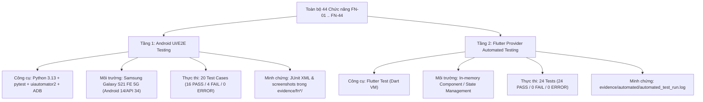

# BÁO CÁO TỔNG KẾT THỰC THI KIỂM THỬ TỰ ĐỘNG (AUTOMATION EXECUTION SUMMARY)

**Dự án:** Smart Note App · **Nhánh được báo cáo:** `huong` · **Ngày lập báo cáo:** 13/10/2026
**Commit tích hợp Provider:** `73514ad` (`test(qa): integrate 24 passing automated provider tests from thuong`)
**Commit tài liệu baseline:** `76df421`
**Tiêu chuẩn áp dụng:** IEEE 829 & ISTQB Test Execution / Test Automation Reporting
**Bản chất báo cáo:** Tổng hợp, cấu trúc lại và đối chiếu toàn diện các chứng cứ thực thi lịch sử; **không có lần chạy test mới nào được thực hiện khi tạo tài liệu này**.

---

## 1. Executive Summary — Các đơn vị đo lường độc lập

Dự án áp dụng **Kiến trúc Kiểm thử Tự động Hai Tầng (Two-Layer Automation Strategy)** để phân tách rạch ròi giữa kiểm thử luồng người dùng trên thiết bị thật và kiểm thử logic quản lý trạng thái trong bộ nhớ:



### Bảng số liệu tổng hợp toàn hệ thống:

| Chỉ số tổng hợp | Tầng 1: Android UI/E2E | Tầng 2: Flutter Provider | Toàn hệ thống Automation |
| :--- | :---: | :---: | :---: |
| **Công nghệ & Framework** | Python 3.13 + pytest + uiautomator2 | Flutter Test (Dart) | Python + Dart |
| **Môi trường thực thi** | Samsung Galaxy S21 FE 5G (API 34) | Dart VM trong bộ nhớ | Máy thật + In-memory |
| **Tổng kịch bản thiết kế** | 31 Test Cases ứng viên | 24 Tests | 55 kịch bản thiết kế |
| **Kịch bản đã thực thi** | **20 Test Cases** | **24 Tests** | **44 Kịch bản kiểm thử** |
| **Số ca ĐẠT (PASS)** | **16** (80.00%) | **24** (100.00%) | **40 Ca ĐẠT (90.91%)** |
| **Số ca THẤT BẠI (FAIL)** | **4** (20.00%) | **0** (0.00%) | **4 Ca THẤT BẠI (9.09%)** |
| **Số ca LỖI (ERROR)** | **0** | **0** | **0** |
| **Backlog UI chưa chạy** | **11** (3 Planned + 8 Deferred) | Không áp dụng | **11 Test Cases (Không cộng vào 44)** |
| **Phạm vi chức năng bao phủ** | 6 FNs (FN-02, 04, 08, 09, 20, 23) | 10 FNs (FN-08..14, 20, 23, 40) | **12 FNs có test chính thức đã chạy** |
| **Bằng chứng thực thi** | JUnit XML và screenshot theo FN | Log `automated_test_run.log` | Logs + Screenshots |

**Nguyên tắc số liệu:**
- $\mathbf{40\ \text{PASS} + 4\ \text{FAIL} = 44\ \text{test executions}}$ trên toàn hệ thống tự động hóa.
- **44 automated tests không đồng nghĩa với 44 FN đã được tự động hóa.** Thực tế có **12/44 FNs (27.27%)** đã có ít nhất một bài kiểm thử tự động chính thức chạy thực tế.
- 11 Test Cases UI chưa chạy thuộc danh mục tồn đọng (Backlog), không được tính vào số bài test đã thực thi.
- Số liệu này hoàn toàn tách bạch với 18 Unit Tests baseline, 8 Security Rules Tests của White-box và 140 execution items kiểm thử thủ công (Black-box).

---

## 2. Môi trường và Phương pháp kiểm thử

- **Android UI/E2E Testing:**
  - Thiết bị: Samsung Galaxy S21 FE 5G (SM-G990B), chạy Android 14 (API 34).
  - Kết nối và công cụ: Cáp USB qua Android ADB; Python 3.13, pytest, uiautomator2.
  - Cơ chế tìm kiếm phần tử: Dynamic-First (ưu tiên `text`, `content-description` và `xpath` của Flutter) kết hợp Coordinate-Fallback (tọa độ dự phòng) khi cần thiết.
  - Quản lý tài khoản: Dùng tài khoản QA riêng; không công khai thông tin bảo mật nhạy cảm trong hồ sơ.
- **Flutter Provider Testing:**
  - Nền tảng: Dart VM, `flutter test`.
  - Bộ kiểm thử: `test/automated/note_provider_test.dart` (15 tests) và `test/automated/sync_provider_test.dart` (9 tests).
  - Giả lập: Sử dụng `FakeNoteRepository`, `FakeSyncRepository` và mock MethodChannel (connectivity, local notifications) để cô lập hoàn toàn với backend Firebase và phần cứng.
- **Nguồn dữ liệu & Expected Result:**
  - Kế thừa 100% Expected Result từ tài liệu đặc tả gốc [`test_cases/black_box/black_box_test_cases.md`](../../test_cases/black_box/black_box_test_cases.md) và [`docs/qa/automation_test_cases.md`](automation_test_cases.md).
  - Tuyệt đối không thay đổi assertion hoặc kỳ vọng để làm đẹp tỷ lệ PASS.

---

## 3. Kết quả chi tiết Tầng 1: Android UI/E2E (20 Test Cases)

### 3.1. Bảng tổng hợp theo 6 nhóm chức năng đã thực thi

| Nhóm FN | Tên chức năng | TC đã chạy | PASS | FAIL | Tỷ lệ PASS | Mã script thực thi |
| :---: | :--- | :---: | :---: | :---: | :---: | :--- |
| **FN-02** | Đăng ký tài khoản Email/Password | 5 | 4 | 1 | 80.00% | `automation/tests/test_fn02_register.py` |
| **FN-04** | Đăng nhập tài khoản Email/Password | 4 | 1 | 3 | 25.00% | `automation/tests/test_fn04_login.py` |
| **FN-08** | Tạo ghi chú văn bản | 3 | 3 | 0 | 100.00% | `automation/tests/test_fn08_create_note.py` |
| **FN-09** | Chỉnh sửa và tự động lưu ghi chú | 2 | 2 | 0 | 100.00% | `automation/tests/test_fn09_edit_note.py` |
| **FN-20** | Ghim và bỏ ghim ghi chú | 2 | 2 | 0 | 100.00% | `automation/tests/test_fn20_pin_note.py` |
| **FN-23** | Tìm kiếm ghi chú theo văn bản | 4 | 4 | 0 | 100.00% | `automation/tests/test_fn23_search.py` |
| **TỔNG** | **Toàn bộ 6 nhóm UI đã thực thi** | **20** | **16** | **4** | **80.00%** | — |

---

### 3.2. Bảng chi tiết 20 Test Cases UI đã thực thi và Bằng chứng

| TC-ID | FN | Tên kịch bản kiểm thử | Kết quả kỳ vọng (Expected) | Kết quả thực tế (Actual) | Kết quả | Phân loại / Mã lỗi ghi nhận | Minh chứng Screenshot |
| :--- | :---: | :--- | :--- | :--- | :---: | :--- | :--- |
| **TC-BB-001** | FN-02 | Đăng ký tài khoản hợp lệ | Tạo tài khoản, chuyển `EmailVerificationScreen` | Tạo tài khoản, chuyển `EmailVerificationScreen` | **PASS** | — | `evidence/fn02/FN02_TC-BB-001_D01_01.png` |
| **TC-BB-002** | FN-02 | Để trống thông tin khi đăng ký | Chặn gửi; hiển thị yêu cầu nhập đủ thông tin | Chặn, báo *"Vui lòng nhập đầy đủ Email và Mật khẩu."* | **PASS** | — | `evidence/fn02/FN02_TC-BB-002_D01_01.png` |
| **TC-BB-003** | FN-02 | Đăng ký với email thiếu `@` | Hiển thị lỗi định dạng email: *"Định dạng email không hợp lệ."* | Hiển thị: *"Không hỗ trợ tên miền email rác này..."* | **FAIL** | **Application Bug** (gán nhãn nội bộ: `BUG-FN02-01`) | `evidence/fn02/FN02_TC-BB-003_D01_01.png` |
| **TC-BB-004** | FN-02 | Đăng ký mật khẩu dưới 6 ký tự | Chặn gửi; báo mật khẩu phải có ít nhất 6 ký tự | Chặn mật khẩu 5 ký tự, báo cần tối thiểu 6 ký tự | **PASS** | — | `evidence/fn02/FN02_TC-BB-004_D02_01.png` |
| **TC-BB-005** | FN-02 | Đăng ký bằng email đã tồn tại | Không tạo trùng; báo email đã được sử dụng | Báo: *"Email này đã được sử dụng cho một tài khoản khác."* | **PASS** | — | `evidence/fn02/FN02_TC-BB-005_D01_01.png` |
| **TC-BB-006** | FN-04 | Đăng nhập tài khoản hợp lệ | Tài khoản đã xác thực chuyển vào `HomeScreen` | Chuyển `EmailVerificationScreen` do `emailVerified=false` | **FAIL** | **Precondition Issue** (Tài khoản chưa verify email) | `evidence/fn04/FN04_TC-BB-006_D01_01.png` |
| **TC-BB-007** | FN-04 | Đăng nhập sai Mật khẩu | Hiển thị lỗi riêng: *"Mật khẩu không chính xác."* | Báo: *"Email hoặc mật khẩu không chính xác."* (thông báo gộp) | **FAIL** | **Expected Diff / Firebase Unified Msg** (nhãn cũ: `BUG-BB-003`) | `evidence/fn04/FN04_TC-BB-007_D01_01.png` |
| **TC-BB-008** | FN-04 | Đăng nhập tài khoản không tồn tại | Hiển thị lỗi riêng: *"Tài khoản không tồn tại..."* | Báo: *"Email hoặc mật khẩu không chính xác."* (thông báo gộp) | **FAIL** | **Expected Diff / Firebase Unified Msg** (nhãn cũ: `BUG-BB-002`) | `evidence/fn04/FN04_TC-BB-008_D01_01.png` |
| **TC-BB-009** | FN-04 | Đăng nhập để trống Mật khẩu | Form chặn đăng nhập, yêu cầu nhập đủ dữ liệu | Chặn form trống, báo *"Vui lòng nhập đầy đủ Email và Mật khẩu."* | **PASS** | — | `evidence/fn04/FN04_TC-BB-009_D01_01.png` |
| **TC-BB-016** | FN-08 | Tạo ghi chú có tiêu đề & nội dung | Thẻ ghi chú hiển thị cả tiêu đề và nội dung | HomeScreen hiển thị "Họp Lab" + "Nội dung ngắn gọn" | **PASS** | — | `evidence/fn08/FN08_TC-BB-016_D01_01.png` |
| **TC-BB-017** | FN-08 | Tạo ghi chú chỉ có nội dung | Ghi chú được tạo và có preview nội dung | HomeScreen hiển thị preview "Ý tưởng nhanh không tiêu đề" | **PASS** | — | `evidence/fn08/FN08_TC-BB-017_D01_01.png` |
| **TC-BB-018** | FN-08 | Không tạo ghi chú rỗng | Ứng dụng không tạo ghi chú rỗng mới | Không có ghi chú rỗng mới trên HomeScreen | **PASS** | — | `evidence/fn08/FN08_TC-BB-018_D01_01.png` |
| **TC-BB-019** | FN-09 | Chỉnh sửa nội dung ghi chú | Preview hiển thị đúng nội dung đã chỉnh sửa | HomeScreen hiển thị nội dung `"[Đã cập nhật lúc 10:00]"` | **PASS** | — | `evidence/fn09/FN09_TC-BB-019_D01_01.png` |
| **TC-BB-020** | FN-09 | Tự động lưu sau khi chỉnh sửa | Nội dung mới tồn tại sau khi thoát và mở lại | Mở lại ghi chú vẫn giữ nội dung sau debounce 2s | **PASS** | — | `evidence/fn09/FN09_TC-BB-020_D01_01.png` |
| **TC-BB-024** | FN-20 | Ghim ghi chú lên đầu Trang chủ | Xuất hiện phân vùng "Được ghim", note lên đầu | Xuất hiện tiêu đề "Được ghim" và thẻ note ở vùng ưu tiên | **PASS** | — | `evidence/fn20/FN20_TC-BB-024_D01_01.png` |
| **TC-BB-025** | FN-20 | Bỏ ghim ghi chú | Note về danh sách thường; ẩn vùng "Được ghim" | Bỏ ghim, note về danh sách thường; tiêu đề ghim ẩn đi | **PASS** | — | `evidence/fn20/FN20_TC-BB-025_D01_01.png` |
| **TC-BB-026** | FN-23 | Tìm theo từ khóa Tiêu đề | Hiển thị thẻ ghi chú khớp tiêu đề | Kết quả tìm theo tiêu đề "Lịch thi học kỳ" chính xác | **PASS** | — | `evidence/fn23/FN23_TC-BB-026_D01_01.png` |
| **TC-BB-027** | FN-23 | Tìm theo từ khóa Nội dung | Hiển thị thẻ ghi chú khớp nội dung | Kết quả tìm theo nội dung "giấy in A4" chính xác | **PASS** | — | `evidence/fn23/FN23_TC-BB-027_D01_01.png` |
| **TC-BB-028** | FN-23 | Tìm từ khóa không tồn tại | Hiển thị màn hình rỗng "Không tìm thấy kết quả" | Empty State: *"Không tìm thấy kết quả"*, gợi ý thử từ khóa khác | **PASS** | — | `evidence/fn23/FN23_TC-BB-028_D01_01.png` |
| **TC-BB-029** | FN-23 | Tìm với ký tự đặc biệt & SQLi | Không crash; hiển thị màn hình rỗng hợp lệ | Xử lý an toàn chuỗi payload `"' OR 1=1 -- % _ @#$"`, app không crash | **PASS** | — | `evidence/fn23/FN23_TC-BB-029_D01_01.png` |

---

### 3.3. Phân tích chi tiết 4 trường hợp FAIL và Đối chiếu Defect Log

| TC-ID | Nhóm phân loại | Nguyên nhân chi tiết | Đánh giá kỹ thuật & Hành động |
| :--- | :--- | :--- | :--- |
| **TC-BB-003** | **Application Bug** (Lỗi logic hiển thị thông báo) | Khi nhập email thiếu ký tự `@` (`nguoidung_gmail.com`), ứng dụng kích hoạt bộ lọc Disposable Email trước bộ kiểm tra cú pháp, hiển thị: *"Không hỗ trợ tên miền email rác này..."* thay vì thông báo định dạng hợp lệ. | Báo cáo automation ghi nhận nhãn `BUG-FN02-01`. Đây là lỗi thứ tự kiểm tra biểu thức chính quy (Regex validation order) trong form đăng ký. Giữ nguyên Expected Result theo đặc tả. |
| **TC-BB-006** | **Precondition / Test Data Issue** (Không phải lỗi ứng dụng) | Tài khoản test `student_qa@gmail.com` được cấu hình trên Firebase Auth với trường `emailVerified: false`. Do đó, ứng dụng điều hướng sang màn hình Xác thực email (`EmailVerificationScreen`) theo đúng thiết kế bảo vệ tài khoản chưa kích hoạt. | Đây là hành vi đúng của ứng dụng. Kịch bản thất bại do dữ liệu tiền điều kiện chưa đáp ứng yêu cầu `emailVerified: true`. Tuyệt đối **không kết luận đây là lỗi ứng dụng đã xác nhận**; giải pháp là kích hoạt email tài khoản test và retest. |
| **TC-BB-007** | **Expected Result Diff / Security Policy** | Khi nhập sai mật khẩu, ứng dụng hiển thị thông báo gộp của Firebase: *"Email hoặc mật khẩu không chính xác."* thay vì tách riêng thông báo *"Mật khẩu không chính xác."*. | **Lưu ý mã lỗi:** Báo cáo automation cũ từng tạm gán mã `BUG-BB-003`. Cần lưu ý mã này **xung đột với `BUG-003` trong Defect Log chính thức** (`docs/bugs/defect_log.md` quy định `BUG-003` là lỗi HomeScreen thiếu Pull-to-refresh). Thông báo gộp là chuẩn bảo mật quốc tế chống dò quét mật khẩu (CWE-204). |
| **TC-BB-008** | **Expected Result Diff / Security Policy** | Khi nhập tài khoản chưa đăng ký, ứng dụng hiển thị thông báo gộp của Firebase: *"Email hoặc mật khẩu không chính xác."* thay vì tách riêng thông báo *"Tài khoản không tồn tại..."*. | **Lưu ý mã lỗi:** Báo cáo automation cũ từng tạm gán mã `BUG-BB-002`. Cần lưu ý mã này **xung đột với `BUG-002` trong Defect Log chính thức** (`docs/bugs/defect_log.md` quy định `BUG-002` là lỗi Offline Delete thiếu Tombstone). Thông báo gộp là chuẩn bảo mật chống tấn công dò tìm danh sách người dùng (User Enumeration). |

---

## 4. Kết quả chi tiết Tầng 2: Flutter Provider Automated Testing (24 Tests)

### 4.1. Thông tin thực thi & Bằng chứng
- **Commit tích hợp:** `73514ad` từ nhánh `thuong`
- **Tệp mã nguồn:**
  - `test/automated/note_provider_test.dart` (15 tests, 476 dòng code, sử dụng `FakeNoteRepository`)
  - `test/automated/sync_provider_test.dart` (9 tests, 178 dòng code, sử dụng `FakeSyncRepository` & Mock MethodChannel)
- **Lệnh thực thi chính thức:**
  ```powershell
  flutter test --no-pub -r expanded test/automated/ 2>&1 | Tee-Object -FilePath evidence/automated/automated_test_run.log
  ```
- **Tệp bằng chứng log:** [`evidence/automated/automated_test_run.log`](../../evidence/automated/automated_test_run.log)
- **Kết quả tổng thể:** **24/24 PASS (100.00%)**, thời gian thực thi: ~00:01s, Exit code: `0`.

---

### 4.2. Bảng kết quả chi tiết từng Test trong 24 Tests Provider

| Ref | File Test | Nhóm kiểm thử (Group) | Tên Test Case trong mã nguồn | Chức năng | Kết quả | Dẫn chứng log (`automated_test_run.log`) |
| :---: | :--- | :--- | :--- | :---: | :---: | :--- |
| **PV-REF-01** | `note_provider_test.dart` | NoteProvider - Pin note | Ghim ghi chú bình thường thành công | **FN-20** | **PASS** | `00:00 +0: NoteProvider - Pin note Ghim ghi chú bình thường thành công` |
| **PV-REF-02** | `note_provider_test.dart` | NoteProvider - Pin note | Bỏ ghim ghi chú đã ghim thành công | **FN-20** | **PASS** | `00:00 +1: NoteProvider - Pin note Bỏ ghim ghi chú đã ghim thành công` |
| **PV-REF-03** | `note_provider_test.dart` | NoteProvider - Archive note | Lưu trữ ghi chú | **FN-13** | **PASS** | `00:00 +2: NoteProvider - Archive note Lưu trữ ghi chú` |
| **PV-REF-04** | `note_provider_test.dart` | NoteProvider - Archive note | Bỏ lưu trữ ghi chú | **FN-14** | **PASS** | `00:00 +3: NoteProvider - Archive note Bỏ lưu trữ ghi chú` |
| **PV-REF-05** | `note_provider_test.dart` | NoteProvider - Restore note | Khôi phục ghi chú từ thùng rác | **FN-11** | **PASS** | `00:00 +4: NoteProvider - Restore note Khôi phục ghi chú từ thùng rác` |
| **PV-REF-06** | `note_provider_test.dart` | NoteProvider - Create and Edit note | Tạo ghi chú mới thành công | **FN-08** | **PASS** | `00:00 +5: NoteProvider - Create and Edit note Tạo ghi chú mới thành công` |
| **PV-REF-07** | `note_provider_test.dart` | NoteProvider - Create and Edit note | Chỉnh sửa tiêu đề và nội dung ghi chú | **FN-09** | **PASS** | `00:00 +6: NoteProvider - Create and Edit note Chỉnh sửa tiêu đề và nội dung...` |
| **PV-REF-08** | `note_provider_test.dart` | NoteProvider - Search note | Search note by content | **FN-23** | **PASS** | `00:00 +7: NoteProvider - Search note Search note by content` |
| **PV-REF-09** | `note_provider_test.dart` | NoteProvider - Search note | Search note with no matching result | **FN-23** | **PASS** | `00:00 +17: NoteProvider - Search note Search note with no matching result` |
| **PV-REF-10** | `note_provider_test.dart` | NoteProvider - Search note | Clear search | **FN-23** | **PASS** | `00:01 +18: NoteProvider - Search note Clear search` |
| **PV-REF-11** | `note_provider_test.dart` | NoteProvider - Note lifecycle | Xóa ghi chú: chuyển vào thùng rác | **FN-10** | **PASS** | `00:01 +19: NoteProvider - Note lifecycle Xóa ghi chú: chuyển vào thùng rác` |
| **PV-REF-12** | `note_provider_test.dart` | NoteProvider - Note lifecycle | Khôi phục ghi chú từ thùng rác | **FN-11** | **PASS** | `00:01 +20: NoteProvider - Note lifecycle Khôi phục ghi chú từ thùng rác` |
| **PV-REF-13** | `note_provider_test.dart` | NoteProvider - Note lifecycle | Xóa vĩnh viễn ghi chú trong thùng rác | **FN-12** | **PASS** | `00:01 +21: NoteProvider - Note lifecycle Xóa vĩnh viễn ghi chú trong thùng rác` |
| **PV-REF-14** | `note_provider_test.dart` | NoteProvider - Note lifecycle | Xóa ghi chú đã ghim vào thùng rác | **FN-10, 20** | **PASS** | `00:01 +22: NoteProvider - Note lifecycle Xóa ghi chú đã ghim vào thùng rác` |
| **PV-REF-15** | `note_provider_test.dart` | NoteProvider - Note lifecycle | Khôi phục ghi chú đã ghim từ thùng rác | **FN-11, 20** | **PASS** | `00:01 +23: NoteProvider - Note lifecycle Khôi phục ghi chú đã ghim từ thùng rác` |
| **PV-REF-16** | `sync_provider_test.dart` | SyncProvider - Initial state | Trạng thái ban đầu là idle | **FN-40** | **PASS** | Khởi tạo SyncStatus.idle, isOffline hợp lệ |
| **PV-REF-17** | `sync_provider_test.dart` | SyncProvider - Update user | Không đồng bộ khi userId là null | **FN-40** | **PASS** | Chặn đồng bộ khi không có user |
| **PV-REF-18** | `sync_provider_test.dart` | SyncProvider - Update user | Đồng bộ khi có userId mới | **FN-40** | **PASS** | Tự kích hoạt sync khi nhận user-1 |
| **PV-REF-19** | `sync_provider_test.dart` | SyncProvider - Update user | Không đồng bộ lại khi userId không thay đổi | **FN-40** | **PASS** | Idempotent check: không sync lặp cùng user |
| **PV-REF-20** | `sync_provider_test.dart` | SyncProvider - Update user | Đổi user thì đồng bộ với user mới | **FN-40** | **PASS** | Chuyển user-1 sang user-2 đồng bộ cả 2 |
| **PV-REF-21** | `sync_provider_test.dart` | SyncProvider - Sync now | Phát tín hiệu khi đồng bộ có dữ liệu mới | **FN-40** | **PASS** | Lắng nghe onSyncWithNewData thành công |
| **PV-REF-22** | `sync_provider_test.dart` | SyncProvider - Sync now | Không phát tín hiệu khi không có dữ liệu mới | **FN-40** | **PASS** | Không phát event thừa khi dữ liệu giữ nguyên |
| **PV-REF-23** | `sync_provider_test.dart` | SyncProvider - Sync now | Bắt lỗi khi đồng bộ thất bại | **FN-40** | **PASS** | `SyncProvider Error: Exception: Sync failed` bắt an toàn |
| **PV-REF-24** | `sync_provider_test.dart` | SyncProvider - Status stream | Cập nhật trạng thái khi repository phát trạng thái mới | **FN-40** | **PASS** | Chuyển trạng thái stream syncing -> success |

*Phân tích bổ trợ, liên kết đa chức năng và trùng lặp:*
- **24 bài test duy nhất vs 26 lượt liên kết FN:** Tầng 2 bao gồm chính xác **24 bài test duy nhất** (15 tests trong `note_provider_test.dart` và 9 tests trong `sync_provider_test.dart`). Có tổng cộng **26 lượt liên kết (Mapping instances)** giữa Test và FN vì hai bài test `PV-REF-14` (xóa note đã ghim) và `PV-REF-15` (khôi phục note đã ghim) là các ca kiểm thử tích hợp đa chức năng, vừa kiểm thử vòng đời thùng rác (`FN-10`, `FN-11`), vừa kiểm tra tính toàn vẹn của cờ ghim (`FN-20`). Việc liên kết đa chức năng này phản ánh đúng thiết kế nghiệp vụ, **không phải bài test bị nhân đôi hay tính trùng mã nguồn**.
- **Trùng lặp nội bộ:** Duy nhất chỉ có cặp bài test `PV-REF-05` (thuộc group *Restore note*) và `PV-REF-12` (thuộc group *Note lifecycle*) trong `note_provider_test.dart` là có mục tiêu kiểm thử logic giống nhau (cùng assert note phục hồi từ trash về status `'normal'`). Hồ sơ giữ nguyên đủ 24 bài test lịch sử nhưng đánh dấu redundancy trong thiết kế để tối ưu khi mở rộng sau này.
- **Bổ trợ đa tầng:** 4 chức năng `FN-08`, `FN-09`, `FN-20`, `FN-23` được kiểm chứng đa tầng (cả UI E2E trên máy thật và Provider in-memory).
- **Mở rộng phạm vi:** 6 chức năng `FN-10`, `FN-11`, `FN-12`, `FN-13`, `FN-14`, `FN-40` được tự động hóa tại tầng Provider mà không bị chặn bởi rào cản UI máy thật.

---

## 5. Ma trận đối chiếu toàn diện 44 chức năng (FN-01 đến FN-44)

| Phân loại trạng thái | Số lượng FN | Danh sách FN chi tiết |
| :--- | :---: | :--- |
| **1. Automation chạy thành công chính thức** | **12 FNs** (27.27%) | `FN-02`, `FN-04`, `FN-08`, `FN-09`, `FN-10`, `FN-11`, `FN-12`, `FN-13`, `FN-14`, `FN-20`, `FN-23`, `FN-40` |
| **2. Chỉ có kịch bản thăm dò UI** | **3 FNs** (6.82%) | `FN-05` (Google OAuth), `FN-29` (Kích hoạt khóa vân tay), `FN-30` (Mở khóa vân tay) |
| **3. Bị chặn (BLOCKED)** | **4 FNs** (9.09%) | `FN-31`, `FN-32`, `FN-33` (Gemini AI — lỗi khung đỏ service UI); `FN-44` (Hết bộ nhớ — an toàn máy thật) |
| **4. Chưa tự động hóa** | **25 FNs** (56.82%) | `FN-01`, `FN-03`, `FN-06`, `FN-07`, `FN-15`, `FN-16`, `FN-17`, `FN-18`, `FN-19`, `FN-21`, `FN-22`, `FN-24`, `FN-25`, `FN-26`, `FN-27`, `FN-28`, `FN-34`, `FN-35`, `FN-36`, `FN-37`, `FN-38`, `FN-39`, `FN-41`, `FN-42`, `FN-43` |
| **TỔNG CỘNG KIỂM KÊ** | **44 FNs** (100.00%) | $\mathbf{12 + 3 + 4 + 25 = 44\ \text{FNs}}$ (khớp 100%, không thiếu, không thừa) |

---

## 6. Danh mục tồn đọng UI — 11 Test Cases chưa thực thi

11 Test Cases này thuộc danh mục thiết kế nhưng **chưa chạy trong đợt kiểm thử hiện tại**, tuyệt đối không tính vào mẫu số 44 test executions:

| TC-ID | FN | Tên kịch bản kiểm thử | Code Status | Execution Result | Lý do / Rào cản kỹ thuật |
| :--- | :---: | :--- | :---: | :---: | :--- |
| **TC-BB-010** | FN-05 | Đăng nhập Google OAuth thành công | DEFERRED | **NOT RUN** | Phụ thuộc Google OAuth Dialog hệ thống Android |
| **TC-BB-011** | FN-05 | Hủy đăng nhập Google OAuth | DEFERRED | **NOT RUN** | Phụ thuộc Google OAuth Dialog hệ thống Android |
| **TC-BB-012** | FN-29 | Kích hoạt khóa sinh trắc học | DEFERRED | **NOT RUN** | Phụ thuộc phần cứng cảm biến vân tay trên thiết bị thật |
| **TC-BB-013** | FN-30 | Mở khóa sinh trắc học thành công | DEFERRED | **NOT RUN** | Phụ thuộc Biometric Prompt hệ thống Android |
| **TC-BB-014** | FN-30 | Mở khóa sinh trắc học thất bại | DEFERRED | **NOT RUN** | Phụ thuộc Biometric Prompt hệ thống Android |
| **TC-BB-015** | FN-30 | Duy trì bảo vệ khi hủy hộp thoại sinh trắc học | DEFERRED | **NOT RUN** | Phụ thuộc tương tác hủy Biometric Prompt hệ thống |
| **TC-BB-021** | FN-10 | Chuyển ghi chú vào thùng rác trên UI | PLANNED | **NOT RUN** | Kế hoạch Phase 2 UI; Provider đã kiểm thử logic PASS |
| **TC-BB-022** | FN-11 | Khôi phục ghi chú từ thùng rác trên UI | PLANNED | **NOT RUN** | Kế hoạch Phase 2 UI; Provider đã kiểm thử logic PASS |
| **TC-BB-023** | FN-12 | Xóa vĩnh viễn ghi chú khỏi thùng rác trên UI | PLANNED | **NOT RUN** | Kế hoạch Phase 2 UI; yêu cầu môi trường QA an toàn dữ liệu |
| **TC-BB-030** | FN-40 | Tạo ghi chú offline và tự động đồng bộ khi online | DEFERRED | **NOT RUN** | Yêu cầu điều khiển ngắt/bật mạng tự động trên thiết bị thật |
| **TC-BB-031** | FN-41 | Giải quyết xung đột LWW giữa hai thiết bị | DEFERRED | **NOT RUN** | Yêu cầu 2 thiết bị vật lý hoạt động đồng thời; cần xác nhận BR-03 |

---

## 7. Thư mục báo cáo JUnit XML, Log và Minh chứng

| Nhóm kiểm thử | Script thực thi | Báo cáo JUnit XML | Báo cáo chi tiết Markdown |
| :--- | :--- | :--- | :--- |
| **FN-02 (Register)** | `automation/tests/test_fn02_register.py` | `automation/reports/fn02_register_junit.xml` | `automation/reports/fn02_automation_report.md` |
| **FN-04 (Login)** | `automation/tests/test_fn04_login.py` | `automation/reports/fn04_login_junit.xml` | `automation/reports/fn04_automation_report.md` |
| **FN-08 (Create Note)**| `automation/tests/test_fn08_create_note.py` | `automation/reports/fn08_create_note_junit.xml` | `automation/reports/fn08_automation_report.md` |
| **FN-09 (Edit Note)** | `automation/tests/test_fn09_edit_note.py` | `automation/reports/fn09_edit_note_junit.xml` | `automation/reports/fn09_automation_report.md` |
| **FN-20 (Pin Note)** | `automation/tests/test_fn20_pin_note.py` | `automation/reports/fn20_pin_note_junit.xml` | `automation/reports/fn20_automation_report.md` |
| **FN-23 (Search)** | `automation/tests/test_fn23_search.py` | `automation/reports/fn23_search_junit.xml` | `automation/reports/fn23_automation_report.md` |
| **Provider (24 tests)**| `test/automated/` | — | Log: `evidence/automated/automated_test_run.log` |

---

## 8. Giới hạn, Khuyến nghị và Kết luận

- **Đánh giá chất lượng:**
  - Đạt **40 PASS / 4 FAIL** trên tổng số **44 kịch bản tự động hóa chính thức đã thực thi** (Tỷ lệ PASS: **90.91%**).
  - 1 ca FAIL do lỗi tiền điều kiện dữ liệu (`TC-BB-006`: `emailVerified=false`).
  - 1 ca FAIL do lỗi ứng dụng (`TC-BB-003`: thứ tự validate email).
  - 2 ca FAIL do ứng dụng trả về thông báo lỗi gộp an toàn của Firebase (`TC-BB-007`, `TC-BB-008`).
- **Khuyến nghị cho đợt kiểm thử tiếp theo:**
  - Chuẩn bị tài khoản test có `emailVerified=true` trước khi chạy lại `FN-04`.
  - Triển khai kịch bản tự động hóa UI cho Phase 2 (`TC-BB-021..023` - Thùng rác) để hoàn thiện luồng UI song song với Provider.
  - Phối hợp với Dev Team sửa lỗi thứ tự kiểm tra email tại `FN-02` (`TC-BB-003`).
- **Quyết định chốt phạm vi:** Bộ kiểm thử tự động chính thức được **KHÓA (FROZEN)** ở mốc 44 kịch bản đã thực thi. Không tự ý sửa đổi số liệu hoặc khẳng định có run mới khi chưa có lệnh chạy thực tế.
